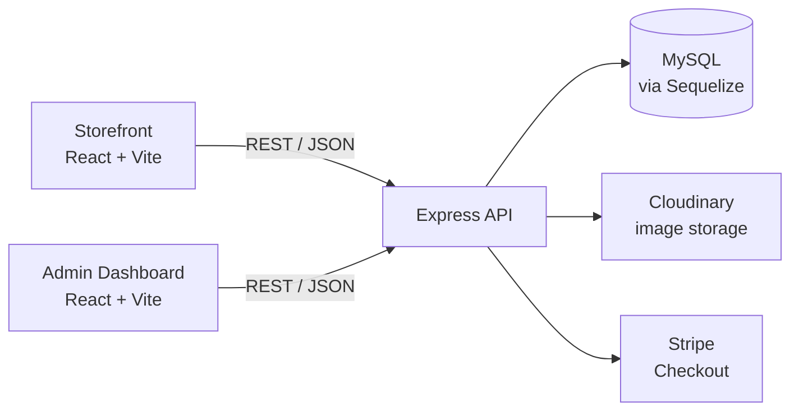

# FOREVER — Full-Stack E-Commerce Platform

A complete e-commerce application for a clothing store: a customer-facing storefront, an admin dashboard for managing products and orders, and a REST API backed by a MySQL database.


---

## Table of Contents

- [Overview](#overview)
- [Features](#features)
- [Tech Stack](#tech-stack)
- [Architecture](#architecture)
- [Project Structure](#project-structure)
- [Getting Started](#getting-started)
- [Environment Variables](#environment-variables)
- [API Reference](#api-reference)
- [Database Schema](#database-schema)
- [Engineering Notes](#engineering-notes)
- [Roadmap](#roadmap)
- [Author](#author)

---

## Overview

FOREVER is split into three independent applications that work together:

| Application | Description | Default port |
| --- | --- | --- |
| `frontend/` | Customer storefront: browse, search, filter, cart, checkout, order history | `5173` |
| `admin/` | Admin dashboard: add and remove products, manage orders and their status | `5174` |
| `backend/` | Express REST API: authentication, products, cart, orders, payments | `4000` |

<!--
Screenshots: add your images to docs/screenshots/ and uncomment this block.


-->

---

## Features

### Storefront

- Home page with the latest collection and bestsellers
- Collection page with category (Men / Women / Kids) and type (Topwear / Bottomwear / Winterwear) filters, text search and sorting by price
- Product pages with an image gallery, size selection and related products
- Shopping cart with quantity updates, kept in `localStorage` and synced with the database for logged-in users
- Checkout with **cash on delivery** or **Stripe Checkout**, with a flat delivery fee
- Order history with the current status of each order
- Customer registration and login with email format and password length validation
- Responsive layout for mobile and desktop

### Admin Dashboard

- Secure admin login, with credentials configured through environment variables
- Add products with up to four images (uploaded to Cloudinary), sizes, category and a bestseller flag
- List and remove products
- View every order with its items, shipping address and payment method
- Update the order status: *Order Placed → Packing → Shipped → Out for delivery → Delivered*

### Backend

- RESTful JSON API with consistent `{ success, message }` responses
- JWT authentication with separate middleware for customers and admins
- Passwords hashed with bcrypt
- Multipart image uploads with Multer, stored on Cloudinary
- Models and tables managed by Sequelize

---

## Tech Stack

| Layer | Technologies |
| --- | --- |
| **Storefront and Admin** | React 19, Vite, React Router 7, Tailwind CSS 4, Axios, React Toastify |
| **Backend** | Node.js (ES modules), Express 5, Sequelize 6, mysql2, JSON Web Tokens, bcryptjs, Multer, validator |
| **Database** | MySQL |
| **Services** | Cloudinary (image hosting), Stripe (payments) |
| **Tooling** | ESLint, Nodemon |

---

## Architecture



---

## Project Structure

```text
fullstack_e-commerce_website/
├── backend/
│   ├── config/          # Sequelize (MySQL) connection and Cloudinary setup
│   ├── controllers/     # User, product, cart and order logic
│   ├── middleware/      # JWT auth (user and admin) and Multer uploads
│   ├── models/          # Sequelize models: User, Product, Order
│   ├── routes/          # Express routers
│   └── server.js        # App entry point
├── frontend/            # Customer storefront
│   └── src/
│       ├── components/  # Reusable UI components
│       ├── context/     # ShopContext: products, cart and auth state
│       ├── pages/       # Home, Collection, Product, Cart, PlaceOrder, Orders...
│       └── assets/
└── admin/               # Admin dashboard
    └── src/
        ├── components/  # Navbar, Sidebar, Login
        └── pages/       # Add, List, Orders
```

---

## Getting Started

### Prerequisites

- Node.js 22 or later
- MySQL 8 or later
- A [Cloudinary](https://cloudinary.com/) account (image uploads)
- A [Stripe](https://stripe.com/) account in test mode (card payments)

### 1. Clone the repository

```bash
git clone https://github.com/deivi313/fullstack_e-commerce_website.git
cd fullstack_e-commerce_website
```

### 2. Create the database

```sql
CREATE DATABASE forever_shop;
```

Only the empty database is needed. The tables are created automatically the first time the backend starts.

### 3. Start the backend

```bash
cd backend
npm install
# create backend/.env (see Environment Variables)
npm run dev
```

The API runs at `http://localhost:4000`. Use `npm start` to run it without Nodemon.

### 4. Start the storefront

```bash
cd frontend
npm install
# create frontend/.env (see Environment Variables)
npm run dev
```

The storefront runs at `http://localhost:5173`.

### 5. Start the admin dashboard

```bash
cd admin
npm install
# create admin/.env (see Environment Variables)
npm run dev
```

The dashboard runs at `http://localhost:5174`. Log in with the `ADMIN_EMAIL` and `ADMIN_PASSWORD` you set in the backend `.env`.

---

## Environment Variables

### `backend/.env`

```env
PORT=4000

# MySQL
DB_HOST=localhost
DB_USER=root
DB_PASSWORD=your_mysql_password
DB_NAME=forever_shop

# Auth
JWT_SECRET=a_long_random_string
ADMIN_EMAIL=admin@example.com
ADMIN_PASSWORD=your_admin_password

# Cloudinary
CLOUDINARY_NAME=your_cloud_name
CLOUDINARY_API_KEY=your_api_key
CLOUDINARY_SECRET_KEY=your_api_secret

# Stripe (use a test key)
STRIPE_SECRET_KEY=sk_test_...
```

### `frontend/.env` and `admin/.env`

```env
VITE_BACKEND_URL=http://localhost:4000
```

> Vite reads `.env` files only at startup, so restart the dev server after changing them.
> To try the Stripe flow in test mode, pay with the card number `4242 4242 4242 4242`, any future expiry date and any CVC.

---

## API Reference

All routes are prefixed with `/api`. Protected routes expect the JWT in a `token` request header.

| Method | Endpoint | Access | Description |
| --- | --- | --- | --- |
| POST | `/user/register` | Public | Create a customer account |
| POST | `/user/login` | Public | Log in and receive a JWT |
| POST | `/user/admin` | Public | Admin login |
| GET | `/product/list` | Public | List all products |
| POST | `/product/single` | Public | Get one product by id |
| POST | `/product/add` | Admin | Add a product with up to 4 images (multipart) |
| POST | `/product/remove` | Admin | Remove a product |
| POST | `/cart/get` | User | Get the user's cart |
| POST | `/cart/add` | User | Add an item to the cart |
| POST | `/cart/update` | User | Update an item's quantity |
| POST | `/order/place` | User | Place an order (cash on delivery) |
| POST | `/order/stripe` | User | Create a Stripe Checkout session |
| POST | `/order/verifyStripe` | User | Handle the Stripe success or cancel redirect |
| POST | `/order/userorders` | User | List the user's orders |
| POST | `/order/list` | Admin | List all orders |
| POST | `/order/status` | Admin | Update an order's status |

---

## Database Schema

The schema is defined with Sequelize models and created automatically on startup with `sequelize.sync()`.

| Table | Main columns |
| --- | --- |
| `users` | `id`, `name`, `email` (unique), `password` (bcrypt hash), `cartData` (JSON) |
| `products` | `id`, `name`, `description`, `price` (DECIMAL), `image` (JSON array of URLs), `category`, `subCategory`, `sizes` (JSON), `bestseller` |
| `orders` | `id`, `userId`, `items` (JSON), `amount` (DECIMAL), `address` (JSON), `status`, `paymentMethod`, `payment` |

Every table also has Sequelize's `createdAt` and `updatedAt` timestamps, which the storefront uses to display order dates.

---

## Engineering Notes

- **Relational data model.** Fixed-shape data lives in typed columns. Variable-shape data (the cart, order items, the shipping address, product sizes and image URLs) is stored in JSON columns. Money uses `DECIMAL(10, 2)`, with getters that return numbers to the client.
- **Authentication.** Stateless JWT auth, bcrypt-hashed passwords, and separate middleware for customer and admin routes.
- **Image pipeline.** Images are uploaded through Multer to Cloudinary, and only their URLs are persisted in the database.
- **Cart synchronisation.** The cart works for guests through `localStorage` and syncs with the database once the user logs in.
- **Shared state.** The storefront keeps products, cart and auth state in a single React Context.
- **Separation of concerns.** The storefront, the admin dashboard and the API are independent applications. Each has its own dependencies and its own configuration.

---

## Author

**Deivi Boja**

- GitHub: [@deivi313](https://github.com/deivi313)
- LinkedIn: [your-linkedin-profile](https://www.linkedin.com/in/your-linkedin-profile)
- Email: your.email@example.com
